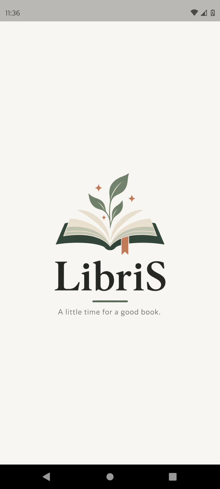

# 01. Splash Screen

## Cél

Az alkalmazás indításakor megjelenő animált képernyő. Feladata az `AnimatedLibrisLogo` lejátszása, miközben eldől, hogy a felhasználót a Login vagy a Home képernyőre kell-e irányítani.

## Navigáció

- **Honnan érhető el:** Az alkalmazás hideg indításakor (`main.dart` -> `SplashScreen`).
- **Hova visz tovább:**
  - `MainNavigationScreen`-re, ha a felhasználó be van jelentkezve és a "Remember me" be volt kapcsolva.
  - `LoginScreen`-re minden más esetben (kijelentkezés vagy nincs "Remember me").

## Működés / Logika

1. Megvárja az animáció végét (`onCompleted`).
2. Lekéri a `PreferencesService`-ből a "Remember me" állapotát.
3. Ha a "Remember me" hamis, de a Firebase-ben mégis van bejelentkezett user, akkor kijelentkezteti (`signOut()`).
4. A navigáció egy `PageRouteBuilder`-rel történik, 550ms-es szép `FadeTransition` animációval.

## Screenshotok

