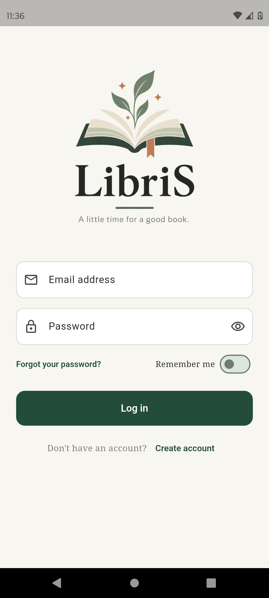

# 02. Login Screen

## Cél

Bejelentkezés meglévő fiókkal email és jelszó segítségével.

## UI Elemek

- **Logó:** Reszponzív kép (`FractionallySizedBox`).
- **Email mező:** Validáció regex alapján.
- **Jelszó mező:** Szem ikonnal (show/hide), minimum 6 karakter validáció.
- **Remember me kapcsoló:** `Switch.adaptive` (zöld színekkel).
- **Gombok:** "Log in", "Forgot your password?", "Create account".

## Működés / Logika

- Az `AuthService.signIn()` metódust hívja.
- **Kivételkezelés:** Ha a user létezik, de az email nincs megerősítve (`EmailNotVerifiedException`), a SnackBar piros hibaüzenetet jelez.
- Ha a jelszó vagy email hibás, a `FirebaseAuthException` kódját lefordítja emberi nyelvre (pl. "Incorrect email address or password.").
- Sikeres belépéskor menti a "Remember me" állapotot a `PreferencesService`-en keresztül, és a `MainNavigationScreen`-re navigál.
- **Teszt user:** Az `auth_service.dart`-ben a `teszt@libris.hu` e-maillel rendelkező felhasználó megkerüli az e-mail megerősítés ellenőrzést.

## Screenshotok

