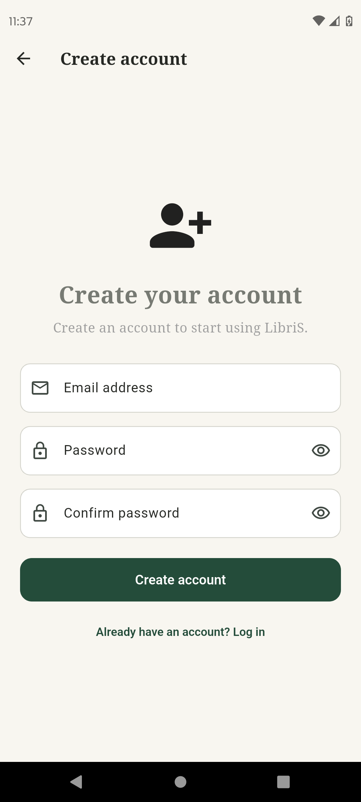

# 03. Register Screen

## Cél

Új fiók létrehozása.

## UI Elemek

- Email, Jelszó, Jelszó megerősítése mezők.
- "Create account" gomb.

## Működés / Logika

- **Jelszó szabályok:** Legalább 8 karakter, tartalmazzon legalább egy nagybetűt és egy számot.
- Az `AuthService.register()` hívódik meg, ami a következő lépéseket végzi el:
  1. Létrehozza a Firebase Auth fiókot.
  2. **Adatbázis inicializálás:** Beállítja a felhasználó kezdeti adatait a Firestore `users` kollekciójában.
  3. Kiküldi a verifikációs e-mailt.
- **Feltétel a Firestore-ba mentésre:** A felhasználó profilja a Firestore-ban csak akkor lesz teljes értékűen használható és elmentve, ha az e-mail címét a felhasználó sikeresen validálta (ezt a folyamatot a `VerifyEmailScreen` kezeli). Ez a folyamat biztosítja, hogy csak létező és elérhető e-mail címmel lehessen regisztrálni és bejelentkezni.
  *(Fejlesztői megjegyzés: A jelenlegi `auth_service.dart` implementáció a Firebase Auth fiók létrehozásakor azonnal elmenti a `users` dokumentumot, de a bejelentkezést a `signIn` metódus mindaddig blokkolja és kijelentkezteti a usert, amíg az e-mail nincs verifikálva.)*
- Sikeres regisztráció után a `pushAndRemoveUntil` segítségével a `VerifyEmailScreen`-re navigál (átadva az emailt paraméterként).

## Screenshotok

