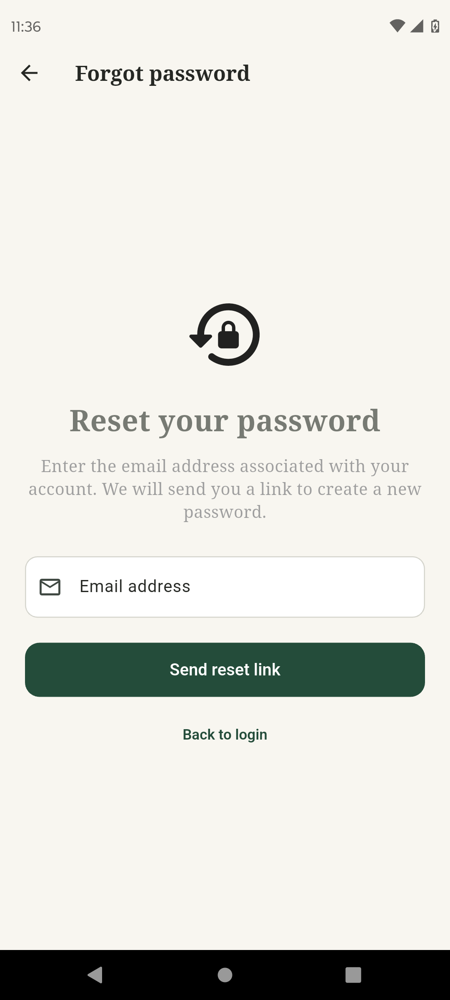
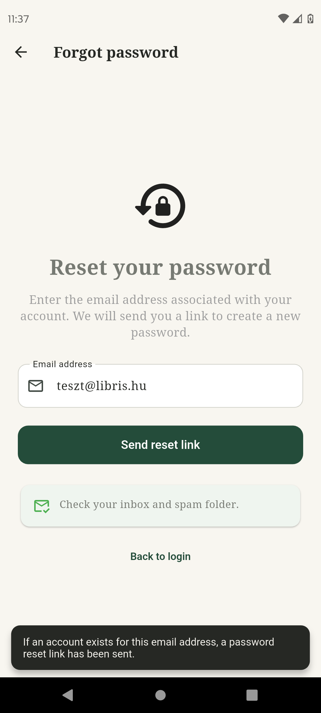

# 04. Forgot Password Screen

## Cél

Jelszó-visszaállító e-mail kérése.

## Működés / Logika

- Az `AuthService.sendPasswordResetEmail()` metódust hívja.
- Ha sikeres: Egy SnackBar tájékoztat ("If an account exists..."), és megjelenik egy zöld kártya ("Check your inbox and spam folder.").
- Biztonsági okokból nem árulja el, hogy létezik-e az adott e-mail cím a rendszerben.
- Hiba esetén (pl. `too-many-requests` vagy hálózati hiba) SnackBar üzenetet ad.

## Screenshotok

