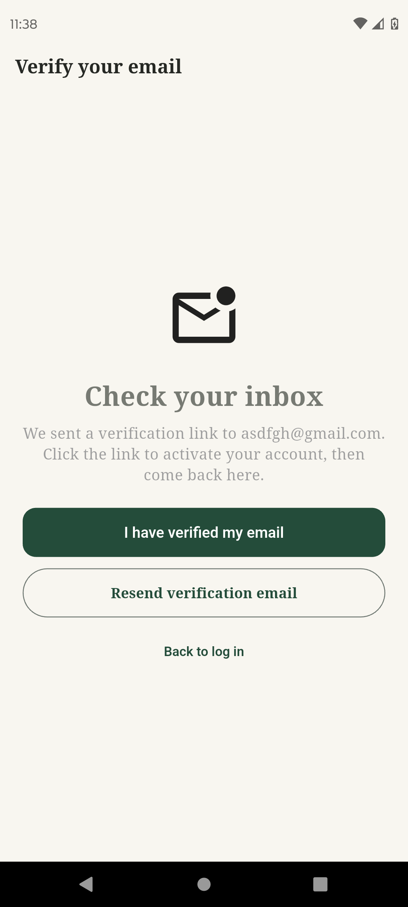

# 05. Verify Email Screen

## Cél

A regisztráció után ide kerül a felhasználó, hogy megerősítse az e-mail címét.

## UI Elemek

- Szöveg: "Check your inbox" és az e-mail cím.
- "I have verified my email" gomb.
- "Resend verification email" gomb.
- "Back to log in" gomb.

## Működés / Logika

- **Ellenőrzés:** A gombnyomásra meghívja a `user.reload()` metódust (hogy a cache ne csaljon), majd ellenőrzi az `emailVerified` állapotot. Ha igaz, a `MainNavigationScreen`-re lép.
- **Újraküldés:** Az `AuthService.sendVerificationEmail()`-t hívja, és zöld szöveggel jelzi a sikert.
- **Visszalépés:** Kijelentkezteti a felhasználót és a Login-ra irányít.

## Screenshotok

