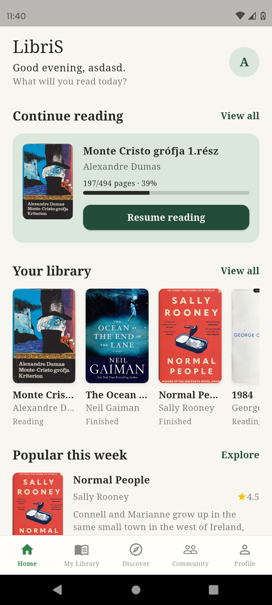
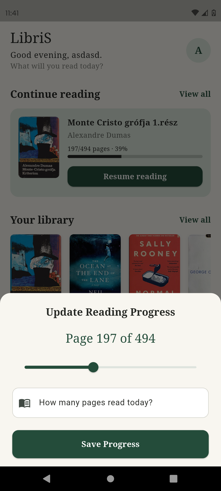
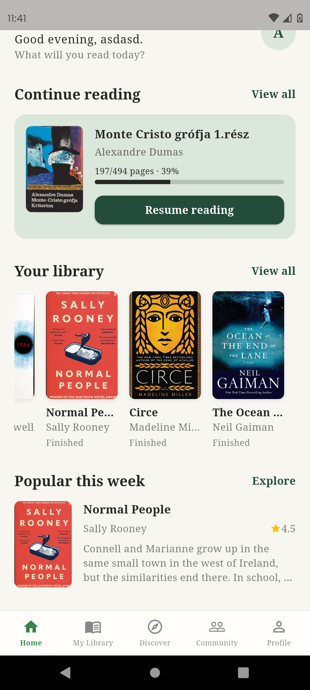

# 07. Home Screen

## Cél

A fő dashboard, ami áttekintést ad a felhasználó olvasmányairól, és lehetőséget biztosít a gyors folytatásra, valamint új könyvek felfedezésére.

## UI Elemek

A képernyő négy fő szekcióra tagolódik:

1. **Header (Fejléc):**
   - **Köszönés:** A napszak alapján dinamikusan változik (Good morning, Good afternoon, Good evening).
   - **Név:** A felhasználó keresztneve (a Firebase `displayName`-jéből, vagy ha az nincs, az e-mail címéből generálva).
   - **UserAvatar:** Egy saját fejlesztésű widget, ami a felhasználó nevének kezdőbetűjét jeleníti meg egy körben.
2. **Continue reading (Olvasás folytatása):**
   - `SectionHeader` widget: Cím ("Continue reading") és egy "View all" gomb.
   - `BookCardHorizontal` widget: A legutóbb olvasott könyv adatai (borító, cím, szerző, oldalszám, százalék, progress bar).
   - **Akciógomb:** Egy "Resume reading" gomb, ami megnyitja a frissítő ablakot (bottom sheet).
3. **Your library (Könyvtárad):**
   - `SectionHeader` widget: Cím ("Your library") és egy "View all" gomb.
   - Vízszintes görgethető lista, ami `LibraryBookCard` widgeteket tartalmaz (borító, cím, szerző, státusz felirat).
4. **Popular this week (Népszerű ezen a héten):**
   - `SectionHeader` widget: Cím ("Popular this week") és egy "Explore" gomb.
   - Egy kiemelt könyv részletesebb nézete: nagyobb borító, cím, szerző, egy statikus csillagértékelés (4.5), és egy rövid leírás.

## Működés / Logika

- **Köszönés és Név:** A `_getGreeting()` függvény a `DateTime.now().hour` alapján dönti el a köszönést. A `_getUserName()` a Firebase Auth-ból kéri le az adatokat (ha nincs keresztnév, az e-mail első betűjét nagybetűsíti).
- **Valós idejű adatok (Real-time Streams):**
  - A "Continue reading" (`_continueReadingStream`) és a "Your library" (`_libraryStream`) `StreamBuilder`-t használ. Ha a felhasználó a "My Library" képernyőn módosítja az olvasási állapotot, a Home képernyő azonnal, manuális újratöltés nélkül frissül.
  - A "Continue reading" a `library_entries` kollekcióból kéri le a `status == 'reading'` bejegyzéseket, majd Dart oldalon rendezi őket `lastReadAt` (vagy ha az nincs, `addedAt`) alapján csökkenő sorrendbe.
- **Egyszeri adatlekérés (Future):**
  - A "Popular this week" (`_fetchPopularBook()`) egy `FutureBuilder`-t használ. Lekér 10 könyvet a `books` kollekcióból, majd ezek közül generál egy véletlenszerűt (`dart:math` segítségével).
- **Interakciók:**
  - A "Resume reading" gombra kattintva meghívódik a `showUpdateProgressSheet()` (ugyanaz, mint a My Librarynél).
  - A "View all" gombok a `widget.onNavigateToTab(1)` hívással átváltanak a My Library képernyőre, az "Explore" gomb pedig a `widget.onNavigateToTab(2)` hívással a Discover képernyőre.

## Állapotok

- **Loading (Betöltés):** Amíg a streamek vagy a future adatot várnak, a képernyő közepén egy `CircularProgressIndicator` forog.
- **Error (Hiba):** Ha bármelyik stream vagy future hibát dob, piros szöveggel jelenik meg a hibaüzenet (pl. `Error: ...`).
- **Empty (Üres):** Ha a felhasználónak nincs olvasás alatt álló könyve, a "Continue reading" szekció a "You are not reading any books currently." szöveget mutatja. Ha a könyvtára üres, a "Your library is empty." szöveget mutatja.

## Screenshotok

