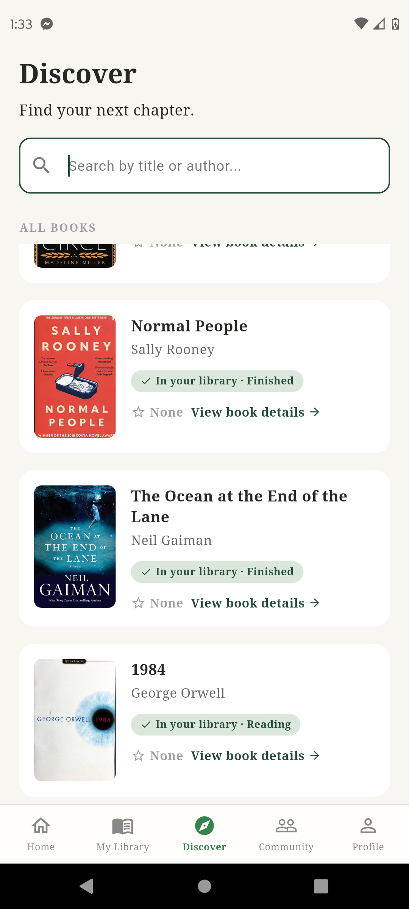

# 08. Discover Screen

## Cél

Új könyvek felfedezése, keresése a központi katalógusból, és a felhasználó könyvtárában való státuszuk (pl. "In your library") megtekintése.

## UI Elemek

- **Header:** "Discover" cím és "Find your next chapter." alcím.
- **Keresősáv (`SearchBarWidget`):** Keresés könyv címére vagy szerzőjére. Kamera ikon és szűrő chipek nélkül.
- **Találatok fejléce:** Pl. "ALL BOOKS" vagy "RESULTS FOR 'keresés'".
- **Könyvlista:** `BookCardHorizontal` widgetek listája. A kártyákon megjelenik:
  - A könyv borítója, címe, szerzője.
  - A felhasználó státusza (pl. "Not in your library", "In your library · Reading").
  - A valós átlagértékelés (pl. "⭐ 4.3" vagy "None"), és egy "View book details →" gomb.

## Működés / Logika

- **Keresés:** A beírt szöveget kisbetűsíti, és minden gombnyomásra szűri a listát a `books` kollekcióból (title és author alapján).
- **Átlagok kiszámítása (Memóriában):** A teljesítmény érdekében a `DiscoverScreen` egyszerre kéri le az összes `reviews` dokumentumot, és egy `Map`-ben kiszámolja a könyvek átlagát. Így nem kell minden kártyához külön adatbázis-hívást indítani.
- **Könyvtár állapot:** Egy másik `StreamBuilder` figyeli a `library_entries` kollekciót a bejelentkezett userhez, így azonnal látszik, ha egy könyv már megvan a felhasználónak.
- **Navigáció:** A kártyára kattintva megnyílik a `BookDetailsScreen`, átadva a `bookId`-t, a könyv adatait (`Map`), és a jelenlegi státuszt.

## Állapotok

- **Loading:** A könyvek és review-k betöltése alatt `CircularProgressIndicator`.
- **Empty:** Ha nincs könyv az adatbázisban, vagy a keresés nem hozott találatot, megfelelő szöveges üzenet jelenik meg.

## Screenshotok

