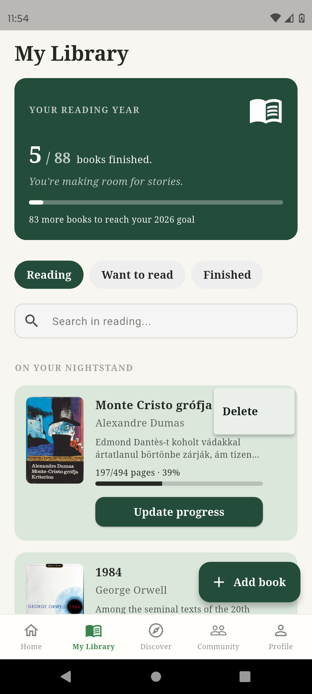
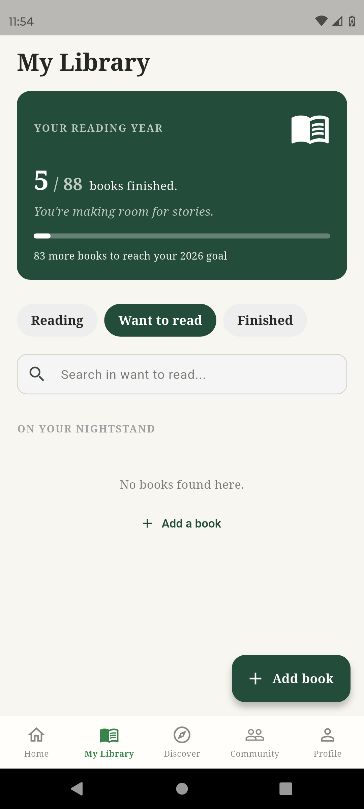
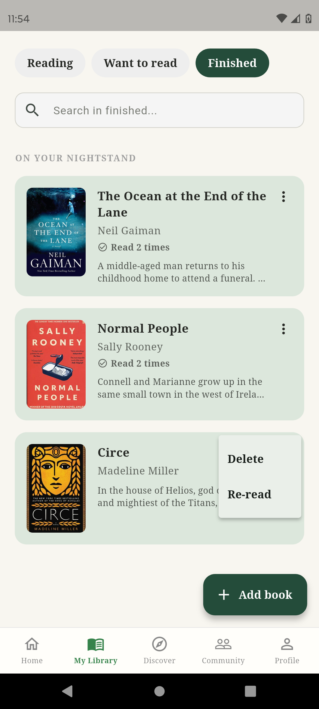

# 09. My Library Screen

## Cél

A felhasználó saját könyvespolca, kategorizálva olvasási állapot szerint.

## UI Elemek

- **Reading Year kártya:** Sötétzöld háttérrel, mutatja az olvasási célt (pl. 5 / 12 books finished). Tartalmaz egy lineáris progress bart (átlátszóság: `withValues(alpha: 0.3)`).
- **Opciók (ChoiceChip):** Reading, Want to read, Finished.
- **Keresőmező:** Az aktuális opción belül szűr cím és szerző alapján.
- **Könyvlista:** `BookCardHorizontal` kártyák.
- **Floating Action Button:** "Add book" gomb, ami a Discover képernyőre visz.
- **Kebab menü (3 pont):** Delete (törlés) és Re-read (újraolvasás, csak 'finished' esetén).

## Működés / Logika

- **Olvasási cél:** A `users` kollekcióból kéri le a `readingGoal`-t, és megszámolja a `finished` státuszú bejegyzéseket.
- **Csoportosítás:** A 'finished' opción a könyveket `bookId` alapján csoportosítja, és megjeleníti, hogy hányszor olvasta már a felhasználó (pl. "Read 2 times").
- **Akciók:**
  - *Start reading:* 'want_to_read' -> 'reading' állapotba teszi.
  - *Update progress:* Megnyitja a `showUpdateProgressSheet` bottom sheetet.
  - *Delete:* Egy `AlertDialog` megerősítése után `batch` törlést hajt végre a Firestore-ban.
  - *Re-read:* Új 'want_to_read' bejegyzést hoz létre ugyanahhoz a könyvhöz.

## Screenshotok

