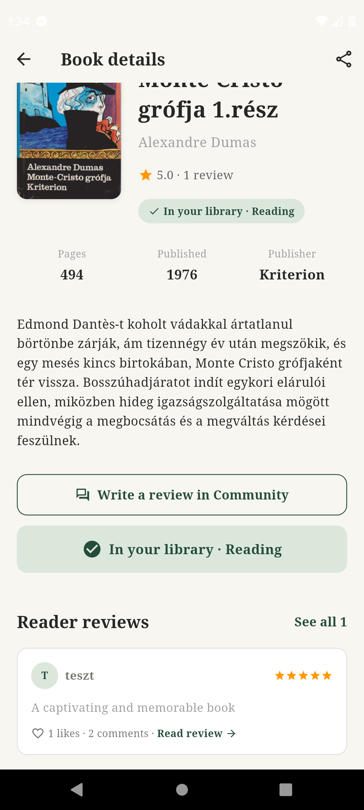

# 10. Book Details Screen

## Cél

Egy kiválasztott könyv részletes adatainak, értékeléseinek és véleményeinek megtekintése, valamint a felhasználó könyvtárába való felvétel.

## UI Elemek

- **Fejléc (`AppBar`):** Vissza gomb, "Book details" cím, és egy Megosztás ikon (jelenleg placeholder, később a Messages screenhez kapcsolódik).
- **Felső szekció (Row):**
  - **Borító:** `BookCover` widget (rugalmas méretezés).
  - **Adatok:** Műfaj, Cím, Szerző.
  - **Értékelés:** Dinamikus átlag és review-k száma (pl. "4.3 · 2 reviews"). Ha nincs review, "None · 0 reviews".
  - **Státusz Badge:** Pl. "In your library · Want to read".
- **Info sáv:** Vízszintesen görgethető. Tartalmazza az oldalszámot, kiadási évet és a kiadót.
- **Leírás:** A könyv rövid tartalma.
- **Akciógombok:**
  - "Write a review in Community" (OutlinedButton): Átirányít a Community fülre.
  - "Add to Library" (ElevatedButton): Ha még nincs a könyvtárban, elmenti `want_to_read` státusszal.
- **Reader reviews:** A legutóbbi 2 review megjelenítése a `ReviewCard` widget segítségével. Ha nincs, "No reviews yet.".

## Működés / Logika

- **Dinamikus átlag:** A `reviews` kollekciót figyeli `bookId` alapján, és kiszámolja az átlagot.
- **Könyvtárhoz adás:** Gombnyomásra létrehoz egy új dokumentumot a `library_entries` kollekcióban `userId`, `bookId`, `status: 'want_to_read'`, `addedAt` és `lastReadAt` mezőkkel.
- **Kattintható kártyák:** A `ReviewCard`-ra kattintva a `ReviewDetailsScreen`-re navigál.

## Állapotok

- **Loading/Error:** A `StreamBuilder`-ek kezelik a betöltést és a hibákat.
- **Könyvtár állapot:** A gomb helyett egy zöld sáv jelenik meg, ha a könyv már a felhasználó birtokában van.

## Screenshotok

