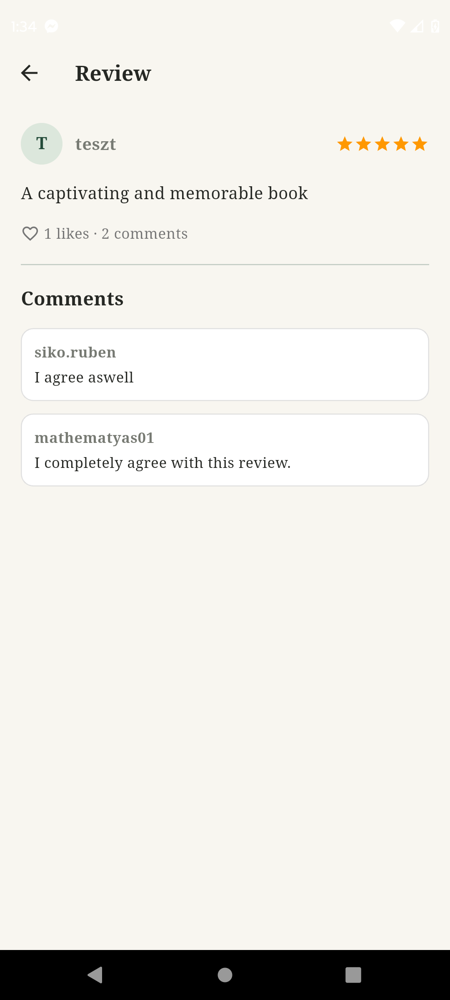

# 11. Review Details Screen

## Cél

Egy konkrét vélemény (review) teljes szövegének és a hozzá tartozó összes hozzászólásnak a megtekintése, valamint a vélemény lájkolása.

## UI Elemek

- **Fejléc (`AppBar`):** Vissza gomb, "Review" cím.
- **Review fejléc:** A szerző avatarja, neve, és csillagértékelése.
- **Review tartalom:** A vélemény címe (ha van) és teljes szövege.
- **Lájk és Komment sáv:** Szív ikon a lájkok számával, és a hozzászólások száma.
- **Hozzászólások (Comments):** A `CommentCard` widgetek listája. Ha nincs hozzászólás: "No comments yet.".

## Működés / Logika

- **Valós idejű adatok:** A review-t `StreamBuilder` figyeli ID alapján, a hozzászólásokat pedig egy másik `StreamBuilder` (szűrve `reviewId` alapján, `createdAt` szerint rendezve).
- **Privacy (Adatvédelem):**
  - Ha a review írója vagy a hozzászóló profilja privát (`accountVisibility: 'private'`), a nevük helyett "Anonymous Reader" / "Anonymous" jelenik meg.
  - **Lájk tiltása:** A `_toggleLikeReview` metódus a művelet előtt leellenőrzi a bejelentkezett felhasználó profilját. Ha az privát, egy piros `SnackBar`-ral jelzi: *"You can't use this feature, your account is private."*, és nem küldi el a kérést a Firebase-nek.
- **Lájk logika:** A kiválasztott review `likedBy` tömbjébe beleteszi vagy kiveszi a felhasználó UID-ját.

## Screenshotok

