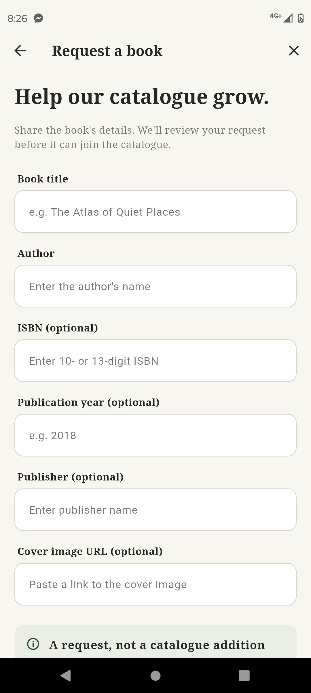
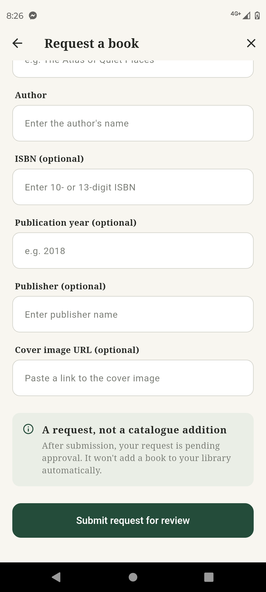

# 12. Book Request Screen

## Cél

Új könyv kérése a központi katalógusba. A felhasználó megadhatja a hiányzó könyv adatait, amit egy adminisztrátor manuálisan bírál el. A beküldött kérés még **nem** kerül be automatikusan a `books` kollekcióba.

## UI Elemek

- **Fejléc (`AppBar`):** Vissza gomb, "Request a book" cím, és egy Bezárás (X) ikon.
- **Cím és leírás:** "Help our catalogue grow." és egy rövid magyarázó szöveg.
- **Form mezők:**
  - **Book title** (kötelező): maximum 200 karakter.
  - **Author** (kötelező): maximum 200 karakter.
  - **ISBN (optional):** csak számjegyek, kötőjel és X engedélyezett; 10 vagy 13 jegyű validáció.
  - **Publication year (optional):** 4 jegyű szám, 1000–2100 közötti tartomány.
  - **Publisher (optional):** maximum 200 karakter.
  - **Cover image URL (optional):** `http://` vagy `https://` séma ellenőrzés.
- **Info banner:** Zöld háttérrel jelzi, hogy a beküldés még nem adja hozzá a könyvet a könyvtárhoz.
- **"Submit request for review" gomb:** Teljes szélességű `FilledButton`, beküldés közben `CircularProgressIndicator`.

## Működés / Logika

- **Validáció:** A `Form` és `TextFormField` validátorok minden beküldés előtt lefutnak. Hiba esetén a mező alatt piros hibaüzenet jelenik meg, a kérés nem indul el.
- **Beküldés:** A `_submit()` metódus először ellenőrzi, hogy van-e bejelentkezett felhasználó. Ezután egy új dokumentumot hoz létre a `book_requests` kollekcióban:
  - `userId`, `proposedTitle`, `proposedAuthor`, `isbn`, `publicationYear`, `publisher`, `imageUrl`
  - `status: 'pending'`
  - `createdAt: FieldValue.serverTimestamp()`
  - `adminNote: ''` (üres string, az admin tölti ki később)
  - `reviewedAt: null`, `seenByUserAt: null`
- **Visszajelzés:** Sikeres beküldés esetén egy SnackBar ("Request submitted for review.") jelenik meg, majd a képernyő bezárul (`Navigator.pop`).
- **Hibakezelés:** Ha a Firestore elutasítja a kérést (pl. `permission-denied`), a teljes hibaüzenet SnackBar-ban jelenik meg, és a form nyitva marad.
- **Biztonság:** A Firestore szabályok csak akkor engedik a beszúrást, ha a `userId` a bejelentkezett felhasználó UID-ja, az `adminNote` üres string, és a `reviewedAt` / `seenByUserAt` mezők `null` értékűek – így a felhasználó nem tudja megkerülni az adminisztrátori elbírálást.

## Állapotok

- **Idle:** A form üres, a Submit gomb aktív.
- **Submitting:** A gomb letiltva, `CircularProgressIndicator` jelenik meg a szöveg helyett.
- **Error:** Validációs hiba esetén a mezők alatt piros szöveg; Firestore hiba esetén SnackBar.

## Screenshotok

