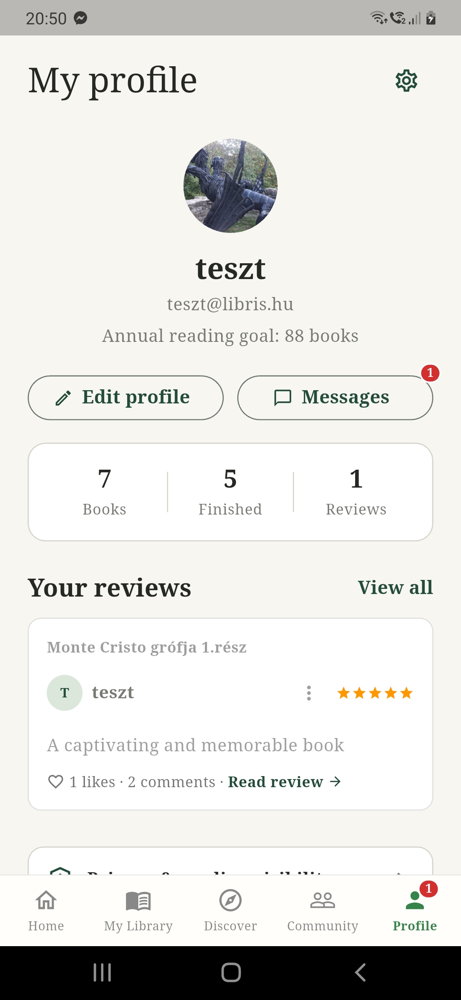
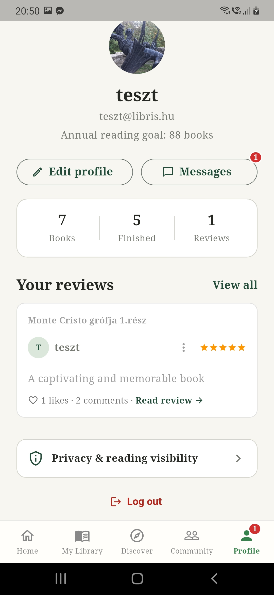

# 12. Profile Screen

## Cél

A bejelentkezett felhasználó profiladatainak, olvasási statisztikáinak, saját értékeléseinek és profilhoz kapcsolódó funkcióinak központi megjelenítése.

## UI Elemek

- **Header:** "My profile" cím és jobb felső beállítás ikon.
- **Profilazonosító:** `UserAvatar`, felhasználónév, e-mail-cím és éves olvasási cél.
- **Edit profile gomb:** Megnyitja az `EditProfileScreen` képernyőt.
- **Messages gomb:** Megnyitja a `MessagesScreen` képernyőt. Olvasatlan üzenet esetén piros számláló badge jelenik meg.
- **Statisztikai kártya:**
  - Books: a felhasználó összes `library_entries` bejegyzése.
  - Finished: a `finished` státuszú bejegyzések száma.
  - Reviews: a felhasználó által írt review-k száma.
- **Your reviews szekció:** A legutóbbi legfeljebb 3 saját értékelés `ReviewCard` widgetekkel.
- **View all:** Megnyitja a `MyReviewsScreen` képernyőt.
- **Privacy & reading visibility:** Megnyitja a `PrivacySettingsScreen` képernyőt.
- **Log out:** Megerősítés után kijelentkezteti a felhasználót.

## Működés / Logika

- **Profiladatok:** A `users/{uid}` dokumentumból tölti be a `username`, `email`, `profileImage` és `readingGoal` mezőket.
- **Könyvstatisztika:** A `library_entries` kollekciót a bejelentkezett felhasználó `userId` értéke alapján kérdezi le.
- **Review-k:** A `reviews` kollekcióból a saját `userId` alapján lekért dokumentumokat dátum szerint csökkenő sorrendbe rendezi.
- **Könyvcímek:** A review `bookId` mezője alapján a `books` kollekcióból tölti be a könyv címét.
- **Profilfrissítés:** Az Edit Profile képernyőről visszatérve újratölti a profiladatokat.
- **Pull-to-refresh:** A teljes profil kézzel is frissíthető.
- **Olvasatlan üzenetek:** A badge azokat a `messages` dokumentumokat számolja, ahol a `receiverId` az aktuális felhasználó UID-je és az `isRead` értéke `false`.
- **Kijelentkezés:** Az `AuthService` kijelentkezteti a felhasználót, a `PreferencesService` törli a Remember me értékét, majd a navigációs előzmények törlésével megnyílik a `LoginScreen`.

## Állapotok

- **Loading:** Profiladatok betöltése alatt `CircularProgressIndicator`.
- **Empty reviews:** Ha nincs saját értékelés, a "No reviews yet" kártya jelenik meg.
- **Error:** Firebase-hiba esetén `SnackBar` jelenik meg.

## Screenshotok

