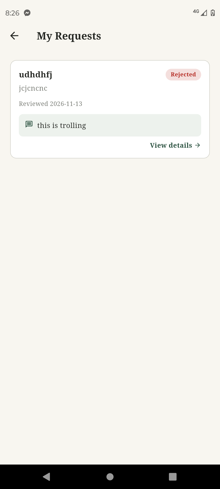
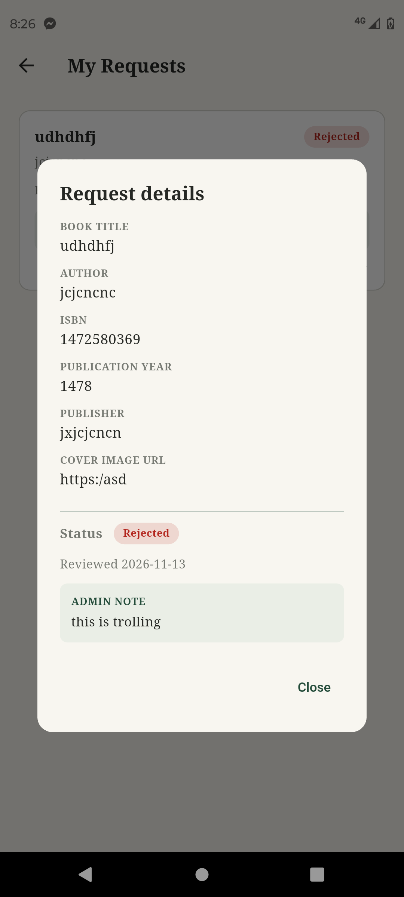

# 13. My Requests Screen

## Cél

A felhasználó saját könyv-kéréseinek áttekintése, szűrése státusz szerint, és az adminisztrátori elbírálás megtekintése. Új elbírálás esetén a `MyRequestsTile` piros ponttal jelzi a Profile screenen (később).

## UI Elemek

- **Fejléc (`AppBar`):** Vissza gomb, "My Requests" cím.
- **Szűrő chipek (`ChoiceChip`):** All / Pending / Approved / Rejected – a `MyLibraryScreen` mintájára vízszintesen görgethető.
- **Kérés kártya (`BookCardHorizontal`):** A beküldött adatok (borító, cím, szerző), státusz badge, és ha elbírálták, a "Reviewed" dátum, valamint az admin megjegyzés zöld háttéren.
- **"View details →" jelzés:** Csak elbírált kérésnél jelenik meg, a kártya koppinthatóvá válik.
- **Részletes dialógus (`AlertDialog`):** Az összes beküldött adat, a státusz, az elbírálás dátuma és az admin megjegyzés.

## Működés / Logika

- **Valós idejű lista:** `StreamBuilder` figyeli a `book_requests` kollekciót `userId` szűrővel. A `createdAt` szerinti csökkenő rendezés **kliensoldalon** történik, így nincs szükség composite indexre.
- **Szűrés:** A kiválasztott chip alapján a lista helyben szűrődik `status` mező szerint.
- **"Látott" jelölés (`_markAllAsSeen`):** A képernyő megnyitásakor a `postFrameCallback` minden olyan elbírált kérésre beállítja a `seenByUserAt: FieldValue.serverTimestamp()` értéket, ahol ez még `null` vagy korábbi, mint a `reviewedAt`. Batch művelettel történik, így egyszerre több dokumentum is frissül.
- **Részletes dialógus:** Csak elbírált kérésnél nyílik meg (amikor `reviewedAt != null`). Pending állapotban a kártya nem koppintható.
- **Admin megjegyzés:** Csak akkor jelenik meg, ha az `adminNote` nem üres string. Az admin a Firebase Console-ból tölti ki az elbíráláskor.
- **Badge logika (`MyRequestsTile`):** A Profile screenre illeszthető `ListTile` egy streamet figyel, ami azon elbírált kérések számát adja vissza, amelyeknél a `seenByUserAt` hiányzik vagy korábbi, mint a `reviewedAt`. Piros számláló badge jelenik meg, ha az érték > 0.

## Állapotok

- **Loading:** A streamek betöltése alatt `CircularProgressIndicator`.
- **Error:** Ha a stream hibát dob, piros szöveggel jelenik meg: "Could not load your requests."
- **Empty:** Ha a felhasználónak egyáltalán nincs kérése: "You haven't requested any books yet." Ha a szűrő alapján nincs találat: "No requests in this category."
- **Reviewed:** A kártyán megjelenik a "Reviewed YYYY-MM-DD" dátum, az admin megjegyzés (ha van), és a koppinthatóság jelzése.
- **Pending:** A kártya csak az alapadatokat és a "Pending" narancssárga badge-et mutatja, nem koppintható.

## Screenshotok

