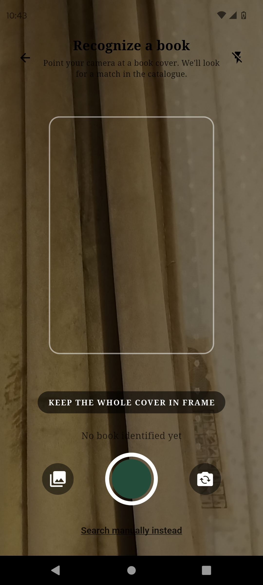
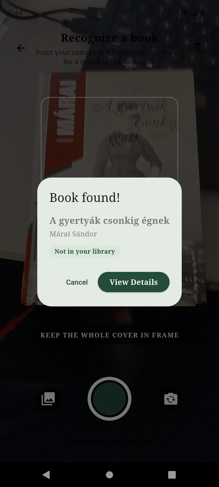
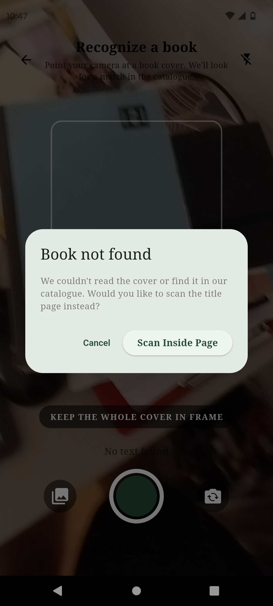

# 14. Book Recognition Screen

## Cél

Egy könyv azonosítása a kamerával készített vagy a galériából kiválasztott kép alapján. A képernyő OCR (Optical Character Recognition) segítségével kiolvassa a borítón vagy a belső címlapon található szöveget, majd intelligens szövegkereséssel megkeresi a könyvet a központi katalógusban (`books` kollekció). Sikeres találat esetén jelzi a felhasználó könyvtárában lévő státuszát, és átirányít a részletek oldalra.

## UI Elemek

- **Kamera előnézet:** Teljes képernyős, élő kamerakép (`CameraPreview`), amely `FittedBox` segítségével tölti ki a rendelkezésre álló teret torzítás nélkül. Sötét overlay (átlátszóság: `withValues(alpha: 0.4)`) biztosítja a jobb olvashatóságot.
- **Felső sáv:**
  - Vissza gomb.
  - Cím ("Recognize a book") és felirat.
  - Villanófény (Flash) kapcsoló ikon.
- **Célkereszt:** Középen elhelyezett, reszponzív fehér keret (`AspectRatio` 3:4), ami segíti a könyv behatárolását.
- **Alsó sáv:**
  - **Instrukciós címke:** "KEEP THE WHOLE COVER IN FRAME" (borító módban) vagy "KEEP THE TITLE PAGE IN FRAME" (belső oldal módban).
  - **Állapotszöveg:** Pl. "No book identified yet", "Processing image...", "Book found!".
  - **Akciógombok:**
    - Bal: Galéria ikon (kép kiválasztása).
    - Közép: Nagy kör alakú Capture gomb (fotózás). Feldolgozás közben `CircularProgressIndicator`-t mutat.
    - Jobb: Kamera csere ikon (első/hátsó kamera).
  - **"Search manually instead" gomb:** Visszalép a Discover képernyőre.
- **Dialógusok:**
  - **"Book found!":** Megjeleníti a címet, szerzőt, a könyvtárban való státuszt (pl. "In your library · Reading"), és egy **"View Details"** gombot.
  - **"Book not found":** Hiba esetén felajánlja a belső címlap beolvasását. Emellett megjeleníti a kiolvasott nyers szöveget (Debug módban) a hibakeresés segítésére.

## Működés / Logika

- **Kamera kezelés:** A `camera` csomag inicializálja a hátlapi kamerát `ResolutionPreset.high` felbontással. Az életciklus (`WidgetsBindingObserver`) figyeli, ha az app háttérbe kerül, ilyenkor felszabadítja a kamerát.
- **Képfeldolgozás (OCR):** A `google_mlkit_text_recognition` csomag (Latin nyelvi modell) olvassa ki a szöveget a képből. A folyamat közös a kamera és a galéria (`image_picker`) által készített képeknél is.
- **Szöveg normalizálása:** A kiolvasott szöveget a rendszer kisbetűsíti, eltávolítja az ékezeteket (pl. `á` -> `a`, `ű` -> `u`), kiszűri az írásjeleket, és szavakra bontja (csak a 3 vagy több karakteres szavakat tartja meg). Ez kiküszöböli az OCR ékezet- és kis/nagybetű-hibáit.
- **Fuzzy Matching (Levenshtein-algoritmus):** Mivel az OCR gyakran ejt hibákat (pl. "A gyertyák csonkig égnek" -> "Agyertyák cionkig égnek"), egy saját fejlesztésű Levenshtein-távolság algoritmus hasonlítja össze az OCR szavait a Firestore-ban lévő könyvek címeivel és szerzőivel. Ha egy szó max. 2 karakterben eltér, hasonlónak számít. Egy találat akkor érvényes, ha a cím vagy a szerző szavainak legalább **70%-a** egyezik.
- **Keresés a Firestore-ban:**
  1. Először egy reguláris kifejezéssel (RegExp) megpróbál ISBN-számot (10 vagy 13 jegyű szám) keresni a szövegben, mert ez a legpontosabb.
  2. Ha nincs ISBN, az összes `books` dokumentumot lekéri a memóriába (kis katalógus esetén ez hatékony), és a Fuzzy Matching segítségével keresi meg a legvalószínűbb találatot.
- **Könyvtár státusz:** Sikeres találat után egy `where` lekérdezéssel ellenőrzi, hogy a `library_entries` kollekcióban van-e bejegyzés a bejelentkezett felhasználóhoz és a könyvhöz.
- **Hibakezelés és Fallback:** Ha az OCR nem talál szöveget, vagy a keresés nem hoz találatot, a rendszer felajánlja a belső címlap (title page) beolvasását. A kamera nézet ilyenkor átvált "belső oldal" módba.
- **Navigáció:**
  - A **"View Details"** gombra kattintva a dialógus bezárul, és a `BookDetailsScreen`-re navigál (átadva a könyv adatait és a jelenlegi státuszt).
  - A **"Search manually instead"** gomb a `Navigator.pop(context)` segítségével visszadobja a felhasználót a `DiscoverScreen`-re, ahol a keresősáv található.

## Állapotok

- **Loading (Kamera inicializálás):** Amíg a kamera elindul, egy fehér `CircularProgressIndicator` forog a fekete háttéren.
- **Processing (Feldolgozás):** A Capture gombon belül egy töltőkarika jelenik meg, az állapotszöveg pedig "Processing image...".
- **Found (Sikeres találat):** Megjelenik a "Book found!" dialógus a könyv adataival.
- **Not Found (Sikertelen találat):** Megjelenik a "Book not found" dialógus, a kiolvasott nyers szöveggel (Debug), és a "Scan Inside Page" opcióval.
- **Error:** Ha a kamera inicializálása vagy a képfeldolgozás hibára fut, az állapotszöveg pirosan jelzi a hibát (pl. "Error initializing camera...").

## Screenshotok

