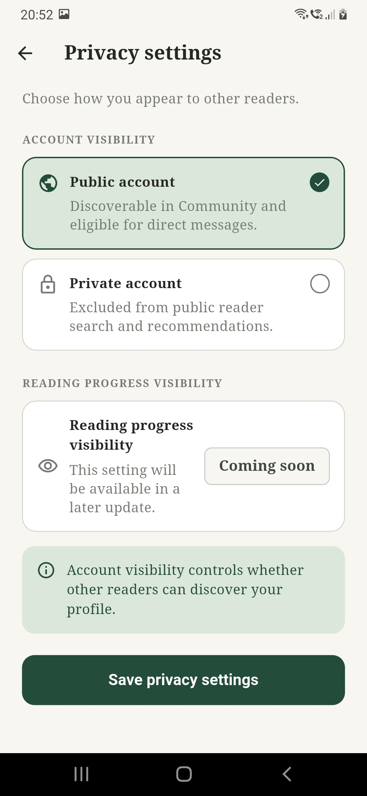

# 14. Privacy Settings Screen

## Cél

A felhasználói profil láthatóságának kezelése a meglévő Firestore-adatmodell módosítása nélkül.

## UI Elemek

- **AppBar:** "Privacy settings" cím és vissza gomb.
- **Account visibility szekció:**
  - Public account
  - Private account
- **Reading progress visibility:** Jelenleg "Coming soon" állapotú tájékoztató kártya.
- **Információs kártya:** Rövid magyarázat a profil felfedezhetőségéről.
- **Save privacy settings:** Elmenti a kiválasztott láthatóságot.

## Működés / Logika

- **Betöltés:** A `users/{uid}` dokumentum `accountVisibility` mezőjét olvassa.
- **Mentés:** A meglévő `accountVisibility` mezőt frissíti `public` vagy `private` értékre.
- **Publikus profil:** Más bejelentkezett felhasználók kereshetik és megnyithatják a publikus profilt.
- **Privát profil:** A profil nem jelenik meg a publikus felhasználókeresésben.
- **Reading progress:** Nem hoz létre új user-mezőt; a funkció későbbi fejlesztésre van fenntartva.

## Állapotok

- **Loading:** Beállítás betöltése alatt `CircularProgressIndicator`.
- **Saving:** A mentés gomb letiltódik és folyamatjelzőt mutat.
- **Success:** Sikeres mentés után `SnackBar` jelenik meg.
- **Error:** Firebase-hiba esetén hibaüzenet jelenik meg.

## Screenshotok

