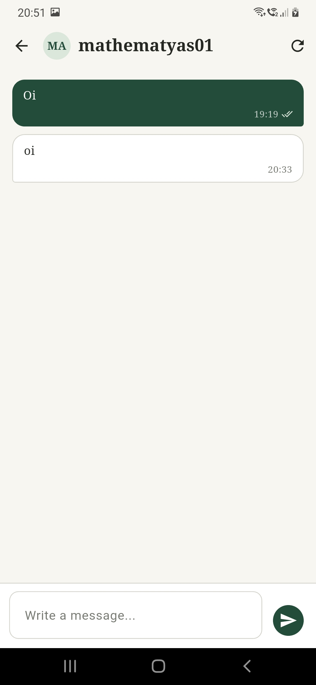

# 16. Chat Screen

## Cél

Két felhasználó közötti privát szöveges beszélgetés megjelenítése és új üzenetek küldése.

## UI Elemek

- **AppBar:** A beszélgetőpartner profilképe, username-je és frissítés ikon.
- **Üzenetbuborékok:**
  - Saját üzenetek jobb oldalon, sötétzöld háttérrel.
  - Kapott üzenetek bal oldalon, világos háttérrel.
- **Időpont:** Minden üzenetnél megjelenik az óra és perc.
- **Olvasási állapot:** Saját üzenetnél egy vagy kettős pipa.
- **Üzenetíró mező:** Többsoros szövegmező, maximum 2000 karakter.
- **Send gomb:** Elküldi az üzenetet.

## Működés / Logika

- **Beszélgetés lekérése:** A `MessageService` mindkét irány üzeneteit lekéri, majd `sentAt` szerint rendezi.
- **Üzenetküldés:** Új dokumentum jön létre a `messages` kollekcióban `senderId`, `receiverId`, `content`, `sentAt` és `isRead` mezőkkel.
- **Olvasottra jelölés:** A képernyő megnyitásakor a kapott, olvasatlan üzenetek `isRead` mezője `true` értékre változik.
- **Automatikus görgetés:** Betöltés és küldés után a lista az utolsó üzenethez görget.
- **Törlés:** A saját üzenet hosszan nyomva törölhető megerősítő dialógus után.
- **Frissítés:** Pull-to-refresh és AppBar frissítés ikon.

## Állapotok

- **Loading:** Beszélgetés betöltése alatt `CircularProgressIndicator`.
- **Empty:** "Start the conversation" állapot, ha még nincs üzenet.
- **Sending:** Küldés alatt a Send gomb folyamatjelzőt mutat.
- **Error:** Jogosultsági vagy hálózati hiba esetén `SnackBar`.

## Screenshotok

