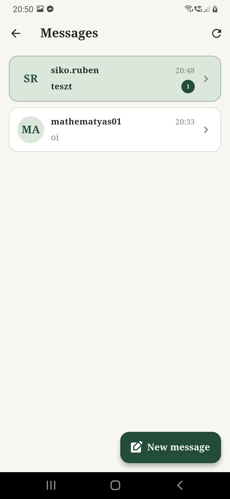

# 15. Messages Screen

## Cél

A felhasználó privát beszélgetéseinek megjelenítése, új beszélgetés indítása és az olvasatlan üzenetek követése.

## UI Elemek

- **AppBar:** "Messages" cím és frissítés ikon.
- **Beszélgetéslista:** A beszélgetőpartner avatarja, felhasználóneve, utolsó üzenete és ideje.
- **Olvasatlan badge:** Piros számláló mutatja az adott beszélgetés olvasatlan üzeneteit.
- **Username kereső dialógus:** Publikus felhasználó keresése pontos username alapján.
- **Empty state:** Tájékoztató nézet, ha még nincs beszélgetés.

## Működés / Logika

- **Üzenetek lekérése:** A `messages` kollekcióból külön lekéri a küldött és fogadott üzeneteket.
- **Beszélgetések csoportosítása:** A dokumentumokat a másik felhasználó UID-je alapján csoportosítja.
- **Utolsó üzenet:** Minden beszélgetésnél a legfrissebb üzenet jelenik meg.
- **Olvasatlan szám:** Azok az üzenetek számítanak olvasatlannak, ahol a jelenlegi user a címzett és `isRead == false`.
- **Felhasználókeresés:** A `users` kollekcióban `username` és `accountVisibility == public` alapján keres.
- **Profiladatok:** A beszélgetőpartner username-je és `profileImage` URL-je a `users/{uid}` dokumentumból érkezik.
- **Navigáció:** Beszélgetés kiválasztásakor megnyílik a `ChatScreen`.
- **Frissítés:** Pull-to-refresh és AppBar frissítés ikon is elérhető.

## Állapotok

- **Loading:** Beszélgetések betöltése alatt `CircularProgressIndicator`.
- **Empty:** "No conversations yet" állapot.
- **No search result:** Ha nincs pontos publikus username-egyezés, külön üzenet jelenik meg.
- **Error:** Jogosultsági vagy Firebase-hiba esetén `SnackBar`.

## Screenshotok

